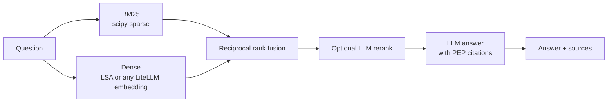

# hybrid-rag-eval

Retrieval-augmented question answering over all 744 Python Enhancement Proposals (PEPs), built to be measured. It combines BM25 and dense retrieval with reciprocal rank fusion, optionally reranks with an LLM, and answers with citations. A hand-written set of 45 questions, each labeled with the PEP that answers it, scores every change.

## Results so far

Document-level retrieval on 45 questions. The corpus is pinned to commit `545c670` of `python/peps`, giving 18,330 chunks of up to 220 words. Every number below comes from `make eval` and is checked into [`results/`](results/).

| Retriever | Hit@1 | Hit@3 | Hit@5 | Hit@10 | MRR |
|---|---:|---:|---:|---:|---:|
| BM25 (from scratch) | 0.556 | 0.733 | **0.844** | **0.889** | **0.677** |
| Dense: LSA-256 (TF-IDF + SVD, local) | 0.511 | 0.667 | 0.733 | 0.800 | 0.604 |
| Hybrid RRF (BM25 + LSA) | 0.489 | 0.667 | 0.800 | 0.867 | 0.614 |

What this shows:

- **BM25 is a hard baseline here.** PEPs are technical and keyword-dense, so exact terms like `ParamSpec`, `zoneinfo` or `except*` do most of the work.
- **A weak dense model makes hybrid worse, not better.** With LSA as the dense half, fusion pulls the right PEP out of first place more often than it rescues a miss. For example, LSA tends to send queries containing "operator" to PEP 465 (the `@` operator), so "walrus operator" goes from PEP 572 at rank 3 under BM25 to PEP 465 at the top under hybrid. Hybrid search only pays off when the dense model gets *different* questions right.
- **The misses are vocabulary mismatches.** "Can I write a big number as 1_000_000?" shares no words with PEP 515's title "Underscores in Numeric Literals". "What does `~=` mean?" fails because the tokenizer drops symbols. These are the cases a neural embedding model should fix.
- **Chunk size barely matters** between 120 and 400 words ([ablation](results/chunk_size_ablation.md)). Each question is worth 0.022, so differences under about 0.05 are noise.

### Not measured yet

These need an API key or a local model, and their tables stay empty until a real run fills them:

| Experiment | Command |
|---|---|
| Dense retrieval with an API embedding model, and hybrid with it | `make index-api eval-api` |
| LLM reranking on top of hybrid | `hybrid-rag eval-answers --rerank ...` |
| End-to-end answer accuracy, citation grounding, cost and latency | `make answers` |

## How it works



1. **Corpus**: `hybrid-rag download` fetches the PEP sources at a pinned commit and parses each RFC 822 header (title, status, Python version).
2. **Chunking**: chunks never cross a reStructuredText section boundary, so every chunk can be cited as "PEP 572, section Abstract". Each chunk is indexed with a short header (PEP number, title, section), which gives a paragraph the document context it lacks on its own.
3. **BM25**: written from scratch in under 90 lines of numpy and scipy. Per-(document, term) weights are precomputed, so a query is a sparse column sum.
4. **Dense**: pluggable. `lsa:256` runs locally with no key. `litellm:<model>` works with any embedding model LiteLLM supports (`text-embedding-3-small`, `ollama/nomic-embed-text`, ...), with an on-disk cache so the corpus is embedded once.
5. **Fusion**: reciprocal rank fusion, `score = Σ 1 / (60 + rank)`. It needs no score calibration between retrievers.
6. **Answering**: the model may only use the retrieved excerpts, must cite `[PEP N]`, and must say so when the answer isn't there.

## Evaluation method

- **Retrieval**: chunk results are mapped back to their PEP and de-duplicated in rank order, then scored with Hit@k, Recall@k and MRR against the gold PEP(s).
- **Answers**: an LLM judge compares each answer with a short human-written reference. Two deterministic checks run alongside it: *cites gold* (does the answer cite the right PEP?) and *citations grounded* (does it cite only PEPs it was actually shown?). Token usage and cost are recorded for every call.
- **The eval set** ([`data/eval/questions.jsonl`](data/eval/questions.jsonl)) is written as a user would ask, not copied from PEP text. Every reference answer was checked against the PEP source.

## Quickstart

```bash
pip install -e ".[dev]"
make data        # download the pinned PEP corpus (~20 MB)
make index       # BM25 + LSA index, about 30 s on a laptop, no API key
make eval        # reproduces the table above

hybrid-rag search "positional-only parameters" --mode hybrid
```

With an LLM (any LiteLLM model string):

```bash
export OPENAI_API_KEY=...          # or use a local model: --model ollama/llama3.1
hybrid-rag ask "Can each subinterpreter have its own GIL?" --model gpt-4o-mini
make index-api eval-api answers    # API embeddings, then the full answer evaluation
```

### API

```bash
make serve    # or: docker build -t hybrid-rag-eval . && docker run -p 8000:8000 -e OPENAI_API_KEY hybrid-rag-eval
curl -s localhost:8000/search -H 'content-type: application/json' -d '{"query": "assignment expressions", "k": 3}'
curl -s localhost:8000/ask    -H 'content-type: application/json' -d '{"question": "What does := do?"}'
```

| Endpoint | Body | Returns |
|---|---|---|
| `GET /health` | | index size, model |
| `POST /search` | `query`, `k`, `mode` (`bm25`/`dense`/`hybrid`) | ranked chunks with PEP, section and score |
| `POST /ask` | `question`, `k`, `rerank` | answer, cited PEPs, sources |

The Docker image bakes in the local index so it starts without a key. Generation still needs one.

## Project layout

```
src/hybrid_rag/
  corpus.py      download + parse PEPs (pinned commit)
  chunking.py    section-aware chunking with contextual headers
  bm25.py        Okapi BM25 on scipy.sparse
  embeddings.py  LSA, LiteLLM (cached) and hashing embedders
  retrieval.py   dense index, RRF fusion, retriever modes, index save/load
  generate.py    cited answers + listwise LLM reranker
  evaluate.py    retrieval metrics, LLM judge, answer metrics
  api.py         FastAPI app
  cli.py         hybrid-rag command
data/eval/       45 labeled questions
results/         checked-in evaluation outputs
tests/           33 tests; LLM calls are faked, so CI needs no keys
```

## Limitations and next steps

- 45 questions is enough to catch large regressions, not to rank close variants. The next step is to grow it to 150+ and report confidence intervals.
- The tokenizer drops symbols, so queries like `~=` or `:=` only match through surrounding words. A code-aware tokenizer is a cheap fix to test.
- The LLM judge should itself be validated: hand-grade 50 answers and report agreement with the judge.
- PEP 8 is long and discusses many topics, so its relevant chunk often loses to shorter PEPs. Per-document score normalization is worth trying.

## License

MIT. The PEP texts are public domain or CC0-1.0 and are downloaded at runtime, not redistributed.
